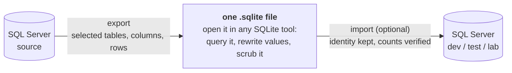

SqlDataPack is a .NET library that exports a slice of a SQL Server database into a single SQLite file, lets you edit it, and lets you import it back into SQL Server.

```csharp
using SqlDataPack;

// Export: SQL Server to one SQLite file
await SqlData.ExportAsync(sourceConnectionString, "database.sqlite");

// Import: that file back into SQL Server
await SqlData.ImportAsync("database.sqlite", targetConnectionString);
```

The file in between is ordinary SQLite, so between those two calls you can open it, query it, and rewrite values, before it goes anywhere near SQL Server again.



Only the tables, columns, and rows you asked for come out. Whoever you hand the file to needs no credentials, and nothing calls anywhere except the SQL Server in your connection string.

## Why not just take a backup?

Native backup and restore is the fastest way to move a database. It's transactionally consistent, preserves everything, and is what you want for disaster recovery. A `.bacpac` is a good portable clone when you need schema and data together, and SqlPackage can already restrict *which tables* carry data, via `/p:TableData`.

Neither of them can drop a column, apply a `WHERE` clause, or give you a stage between extract and load where a script can rewrite values without going back to the source. See [Comparison](/comparison) for the full table against native backup/restore, `.bacpac`/SqlPackage, and `bcp`, and for what each one costs to actually do.

See [Known limitations](/known-limitations) for the hard edges.

## Use it for

- Give a dev, test, QA, or demo environment a filtered, scrubbed slice instead of a full production copy.
- Send a small, scoped snapshot along with a support issue.
- Give an AI coding agent a local, queryable copy of relevant SQL Server tables instead of database credentials.
- Package reproducible database state for bug reports and regression tests.
- Inspect SQL Server data on a machine that does not have SQL Server installed.

## Next

Start with [Getting started](/getting-started).
